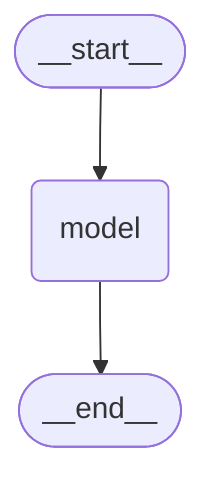

# M1 — Graph foundations (Stages 1–5)

Use case **B — Research Assistant**: a graduate student asks about machine-learning papers
(find papers on a topic, look up a specific arXiv paper, get a citation, explain a concept).
Data: arXiv API (no key), cached in `data/papers.json`; Semantic Scholar API for citation counts.

Model: `gpt-4.1-mini`, temperature 0. Each stage below records what was built, the experiment
table, and the reflection answers.

---

## Stage 1 — A single LLM node

**Built.** `build_graph()` in `app/graph.py`: `StateGraph(State)` with one node `"model"`
(`call_model`), edges `START → model → END`, compiled. `State` has one field, `messages`, with the
`add_messages` reducer. `run.py` sends each question as a fresh run.

**Tests.** `pytest tests/test_stage01.py` → 2 passed (graph compiles with a `model` node; one
invoke returns exactly 2 messages, the last an `AIMessage`).

**Observed.** One run with "What does the ReAct paper propose, in two sentences?" streams a single
update `{"model": {...}}`; the final state holds 2 messages (question + reply); 19 input / 61 output
tokens, 2.6 s.

**Experiment 1 — five research questions** (one fresh run each; questions in
`eval/stage01_questions.jsonl`, raw results in `eval/results/stage01.jsonl`; ground truth from
`data/papers.json`)

| # | question (short) | needs | answer | verdict | tokens in/out | s |
|---|---|---|---|---|---|---|
| 1 | What does LoRA do differently from full fine-tuning, when to use it? | general knowledge | freeze weights, train low-rank matrices; use when memory/storage is the constraint | **correct** | 30 / 690 | 5.7 |
| 2 | Who wrote the ResNet paper, what year? | general knowledge | He, Zhang, Ren, Sun; 2015 | **correct** | 22 / 46 | 1.1 |
| 3 | Citation count of *Attention Is All You Need* on Semantic Scholar now? | live data | "I don't have real-time access…" | honest refusal (no answer) | 25 / 43 | 0.8 |
| 4 | Which papers in *my saved catalogue* are about LLM agents, how many in total? | private data (`data/papers.json`) | "I don't have access to your saved catalogue" | honest refusal (no answer) | 34 / 50 | 1.4 |
| 5 | Exact arXiv id and *latest version* of *Auto-Encoding Variational Bayes*? | rarely-memorised metadata | 1312.6114 **v10** | **confident but invented**: id right, version wrong (v11) | 34 / 65 | 1.1 |

Score: 2 correct, 2 honest "I can't", 1 confident invention. The same graph on the Stage 2 question
set (`eval/results/stage01_on_stage02set.jsonl`, kept as the Stage 2 baseline) added two more
inventions: "the Llama 2 paper has **17** authors" (the catalogue lists 68), and, when asked whether a
made-up reference anchored to arXiv 1908.10084 is real, the model rightly said the paper does not
exist but then asserted that 1908.10084 is "On Layer Normalization in the Transformer Architecture"
(it is Sentence-BERT). The model refuses when the question *announces* that it needs live or private
data, and invents when the question looks like ordinary knowledge but the fact lives in the long tail
(version numbers, author counts, id→title mappings).

**Experiment 2 — memory across runs.** Two *separate* runs:

| run | question | reply |
|---|---|---|
| 1 | My name is Sara. | "Hello Sara! How can I assist you today?" |
| 2 | What is my name? | "I don't have access to your personal information, so I don't know your name." |

Each run starts from an empty state, so run 2 never sees run 1. The final state of each run has
exactly 2 messages. This is the limitation Stage 6 (checkpointer + `thread_id`) fixes.

**Reflection.**

1. *Why does the node return `{"messages": [reply]}` and not the full message list?* A node returns
   an **update**, and the `add_messages` reducer decides how the update merges into the state: it
   appends new messages (and replaces a message that carries the same `id`). The node therefore only
   has to know what *it* produced, not the whole history; several nodes (or parallel branches) can each
   add messages without overwriting each other, and the graph, not the node, owns the conversation.
2. *What if `messages` had no reducer?* A field without a reducer is **overwritten** by whatever the
   node returns. The state after Stage 1 would contain only the reply; the question would be gone, and
   in Stage 2 each of the three nodes would wipe what the previous one wrote. Returning the full list
   from every node would "work" but couples every node to the whole history.
3. *Which questions did the model get wrong, and why could it not know?* Q5 (VAE latest version:
   v10, actually v11), plus "Llama 2 has 17 authors" (68) and "1908.10084 is *On Layer Normalization*"
   (Sentence-BERT). These are long-tail metadata facts that appear rarely or inconsistently in training
   text, and version numbers change after the training cut-off. The model has no way to look anything
   up, and `temperature=0` does not make a guess more accurate, only more repeatable. Q3 and Q4 were
   refused because the wording made the gap obvious ("right now", "my catalogue"). Tools (Stage 4) and
   retrieval over the catalogue (Stage 8) are the fixes; thread memory (Stage 6) fixes "Sara".
