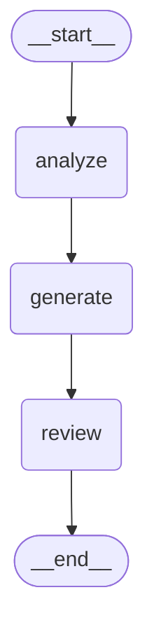
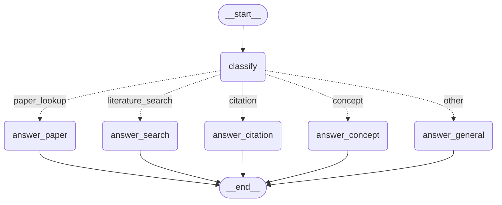
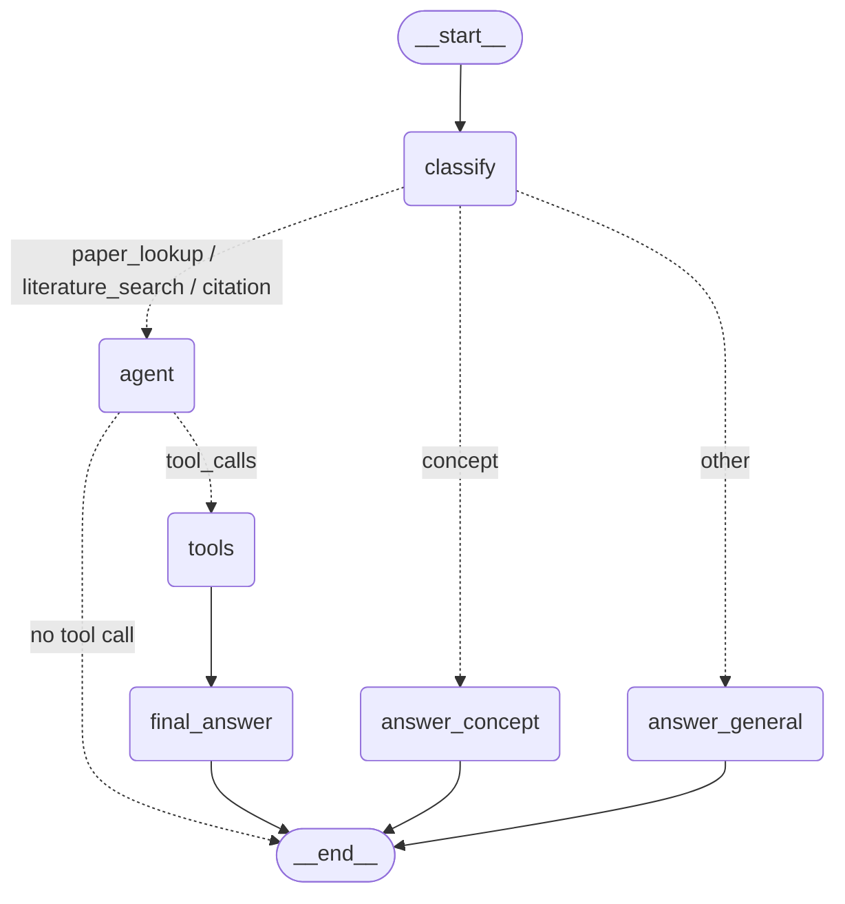

# M1 — Graph foundations (Stages 1–5)

Use case **B — Research Assistant**: a graduate student asks about machine-learning papers
(find papers on a topic, look up a specific arXiv paper, get a citation, explain a concept).
Data: arXiv API (no key), cached in `data/papers.json`; Semantic Scholar API for citation counts.

Model: `gpt-4.1-mini`, temperature 0. Each stage below records what was built, the experiment
table, and the reflection answers.

---

## Stage 1 — A single LLM node

**Built.** `build_graph()` in `app/graph.py`: `StateGraph(State)` with one node `"model"`
(`call_model`), edges `START → model → END`, compiled. `State` has one field, `messages`, with the
`add_messages` reducer. `run.py` sends each question as a fresh run.

**Tests.** `pytest tests/test_stage01.py` → 2 passed (graph compiles with a `model` node; one
invoke returns exactly 2 messages, the last an `AIMessage`).

**Observed.** One run with "What does the ReAct paper propose, in two sentences?" streams a single
update `{"model": {...}}`; the final state holds 2 messages (question + reply); 19 input / 61 output
tokens, 2.6 s.

**Experiment 1 — five research questions** (one fresh run each; questions in
`eval/stage01_questions.jsonl`, raw results in `eval/results/stage01.jsonl`; ground truth from
`data/papers.json`)

| # | question (short) | needs | answer | verdict | tokens in/out | s |
|---|---|---|---|---|---|---|
| 1 | What does LoRA do differently from full fine-tuning, when to use it? | general knowledge | freeze weights, train low-rank matrices; use when memory/storage is the constraint | **correct** | 30 / 690 | 5.7 |
| 2 | Who wrote the ResNet paper, what year? | general knowledge | He, Zhang, Ren, Sun; 2015 | **correct** | 22 / 46 | 1.1 |
| 3 | Citation count of *Attention Is All You Need* on Semantic Scholar now? | live data | "I don't have real-time access…" | honest refusal (no answer) | 25 / 43 | 0.8 |
| 4 | Which papers in *my saved catalogue* are about LLM agents, how many in total? | private data (`data/papers.json`) | "I don't have access to your saved catalogue" | honest refusal (no answer) | 34 / 50 | 1.4 |
| 5 | Exact arXiv id and *latest version* of *Auto-Encoding Variational Bayes*? | rarely-memorised metadata | 1312.6114 **v10** | **confident but invented**: id right, version wrong (v11) | 34 / 65 | 1.1 |

Score: 2 correct, 2 honest "I can't", 1 confident invention. The same graph on the Stage 2 question
set (`eval/results/stage01_on_stage02set.jsonl`, kept as the Stage 2 baseline) added two more
inventions: "the Llama 2 paper has **17** authors" (the catalogue lists 68), and, when asked whether a
made-up reference anchored to arXiv 1908.10084 is real, the model rightly said the paper does not
exist but then asserted that 1908.10084 is "On Layer Normalization in the Transformer Architecture"
(it is Sentence-BERT). The model refuses when the question *announces* that it needs live or private
data, and invents when the question looks like ordinary knowledge but the fact lives in the long tail
(version numbers, author counts, id→title mappings).

**Experiment 2 — memory across runs.** Two *separate* runs:

| run | question | reply |
|---|---|---|
| 1 | My name is Sara. | "Hello Sara! How can I assist you today?" |
| 2 | What is my name? | "I don't have access to your personal information, so I don't know your name." |

Each run starts from an empty state, so run 2 never sees run 1. The final state of each run has
exactly 2 messages. This is the limitation Stage 6 (checkpointer + `thread_id`) fixes.

**Reflection.**

1. *Why does the node return `{"messages": [reply]}` and not the full message list?* A node returns
   an **update**, and the `add_messages` reducer decides how the update merges into the state: it
   appends new messages (and replaces a message that carries the same `id`). The node therefore only
   has to know what *it* produced, not the whole history; several nodes (or parallel branches) can each
   add messages without overwriting each other, and the graph, not the node, owns the conversation.
2. *What if `messages` had no reducer?* A field without a reducer is **overwritten** by whatever the
   node returns. The state after Stage 1 would contain only the reply; the question would be gone, and
   in Stage 2 each of the three nodes would wipe what the previous one wrote. Returning the full list
   from every node would "work" but couples every node to the whole history.
3. *Which questions did the model get wrong, and why could it not know?* Q5 (VAE latest version:
   v10, actually v11), plus "Llama 2 has 17 authors" (68) and "1908.10084 is *On Layer Normalization*"
   (Sentence-BERT). These are long-tail metadata facts that appear rarely or inconsistently in training
   text, and version numbers change after the training cut-off. The model has no way to look anything
   up, and `temperature=0` does not make a guess more accurate, only more repeatable. Q3 and Q4 were
   refused because the wording made the gap obvious ("right now", "my catalogue"). Tools (Stage 4) and
   retrieval over the catalogue (Stage 8) are the fixes; thread memory (Stage 6) fixes "Sara".

---

## Stage 2 — A sequential workflow

**Built.** Two state fields, `analysis` and `draft` (no reducer: each write replaces the value), and
three nodes with Research Assistant prompts: `analyze` (restate the question, list the facts needed),
`generate` (draft an answer given the analysis), `review` (rewrite under 120 words, flag anything it
cannot verify). Fixed path `START → analyze → generate → review → END`. The graph is kept as
`build_workflow()` in `app/graph.py` so it stays testable once Stage 3 changes the entry point.

**Streaming.** `graph.stream(..., stream_mode="updates")` yields `{"analyze": {"analysis": ...}}`,
then `{"generate": {"draft": ...}}`, then `{"review": {"messages": [...]}}`. On "how many authors
are on the Llama 2 paper?" the draft listed 13 names (the *LLaMA 1* author list) and the review kept
them, only adding "I cannot independently verify this author list".

**Tests.** `tests/test_stage02.py` → 1 passed (the three nodes are visited in order).

**Experiment — Stage 1 vs Stage 2 on the same 10 questions** (`eval/stage02_questions.jsonl`;
raw runs in `eval/results/stage01_on_stage02set.jsonl` and `eval/results/stage02.jsonl`). Tokens
are counted per LLM call with `UsageMetadataCallbackHandler`, because Stage 2's intermediate replies
live in state fields, not messages. Quality was scored 1–5 by **three independent LLM graders**
(Claude), blind to which system was which, with `data/papers.json` as ground truth; the table shows
the median (raw grades in `eval/results/stage02_grades.json`).

| # | label | S1 s | S2 s | S1 tok in/out | S2 tok in/out | S1 score | S2 score | note |
|---|---|---|---|---|---|---|---|---|
| 1 | short | 1.8 | 3.6 | 18/67 | 262/194 | 5 | 4 | S2 hedges a fully correct author list |
| 2 | short | 0.7 | 3.1 | 17/11 | 274/197 | 5 | 4 | S2 pads "2018" with unrequested facts |
| 3 | short | 1.0 | 4.2 | 14/69 | 433/425 | 5 | 2 | S2 volunteers a LoRA author list with a **fabricated name** |
| 4 | long | 5.8 | 8.6 | 33/844 | 1142/1160 | 4 | 4 | S1 606 words, S2 132 words; both correct |
| 5 | long | 7.4 | 10.0 | 37/943 | 1483/1483 | 4 | 4 | S2 cites Hu et al. 2021 |
| 6 | long | 8.2 | 9.4 | 32/1146 | 1256/1282 | 4 | 4 | S2 cites Kingma & Welling 2013, Goodfellow 2014 |
| 7 | long | 4.8 | 11.9 | 42/776 | 1700/1709 | 4 | 4 | S2 leaks "numbers in the draft could not be verified" |
| 8 | needs_data | 1.0 | 3.5 | 33/65 | 357/279 | 5 | 3 | both refuse; S2 adds the superseded v1 Reflexion title |
| 9 | needs_data | 0.8 | 4.9 | 19/12 | 539/541 | 1 | 1 | S1 "17 authors", S2 "13 authors" + LLaMA-1 list; truth 68 |
| 10 | needs_data | 3.2 | 7.1 | 62/397 | 811/728 | 2 | 4 | S1 names a wrong paper for 1908.10084; S2 does not |
| **total / mean** | | **34.7** | **66.4** | **307/4330** | **8257/7998** | **3.9** | **3.4** | |

**Is the workflow worth three times the calls?** Not on average: 1.9× latency, 27× input tokens
(the draft and analysis are re-sent), 1.8× output tokens, and a *lower* mean score (3.4 vs 3.9).
Where it helps: the fake-reference check (Q10, 2 → 4: the review step stopped the model from naming
a wrong paper) and the four long trade-off questions, where the 120-word cap produced right-sized,
decision-oriented answers that cite the canonical papers (same score, a quarter of the length). Where
it hurts: short factual questions. The analyze → generate steps *add* facts nobody asked for (author
lists, titles), which gives the model more chances to invent (5 answers with an invented claim vs 2),
and the review node adds "I cannot verify" disclaimers to correct answers while certifying wrong ones
(Q9). A reviewer that only sees the draft cannot check facts; it can only check tone and length. That
is the Stage 4 (tools) and Stage 15 (validation against evidence) motivation.

**Reflection.**

1. *Which state fields does `review` read, and which does it write?* It reads `draft` only (not
   `messages`, not `analysis`), and writes `messages` (one `AIMessage`). `analysis` and `draft` stay
   in the final state as a trace of the run.
2. *One request where this fixed path is the wrong path.* "What year did the BERT paper come out?":
   three calls and 274 input tokens to restate a seven-word question, draft, and review a one-word
   answer the single node got right in 0.7 s. Equally wrong: "How many citations does Reflexion have
   right now?", where no amount of analysing or reviewing can supply the missing number.

---

## Stage 3 — Conditional routing

**Built.** A state field `intent`; a structured-output classifier (`Classification` with one
`Literal` field, so the model can only return one of five labels); a `classify` node; a routing
function `route_by_intent` (not a node: it returns the key the conditional edge looks up); and five
answer nodes, each the same model call with a different system prompt. Intents for the Research
Assistant: `paper_lookup`, `literature_search`, `citation`, `concept`, `other`. The mapping lives in
`ROUTES` in `app/graph.py`; every answer node goes to `END`.

**Tests.** `tests/test_stage03.py` → 2 passed (a BibTeX request routes to `citation`, a topic
request to `literature_search`). `tests/test_stage02.py` now targets `build_workflow()`.

**Experiment — routing accuracy** on 20 labelled requests (`eval/routing.jsonl`: 5 paper_lookup,
5 literature_search, 4 citation, 4 concept, 2 other; each label was checked by a second reviewer
for ambiguity before the run). Only the `classify` node runs (`scripts/eval_routing.py`).

*v1 descriptions* ("citation = produce a BibTeX/APA citation, or verify/correct a reference"):
**18/20 = 90%**.

| true \ predicted | paper_lookup | literature_search | citation | concept | other |
|---|---|---|---|---|---|
| **paper_lookup** | 5 | | | | |
| **literature_search** | | 5 | | | |
| **citation** | 2 | | 2 | | |
| **concept** | | | | 4 | |
| **other** | | | | | 2 |

Both misses are *reference checks* ("Is this a real paper and is the citation correct?", "my .bib
entry … lists only Dosovitskiy … give me a corrected BibTeX") routed to `paper_lookup`: the
request mentions a paper's authors and year, which the v1 description associates with paper facts.

*v2 descriptions* name the deciding cue ("citation = the student is working on a reference or
bibliography entry … even if the question mentions authors or a year; paper_lookup = … and is NOT
checking or producing a reference"): **20/20 = 100%**, confusion table diagonal.
Caveat: v2 was written after looking at v1's misses on the same 20 items, so 100% is an upper bound,
not an estimate of accuracy on new requests; Stage 13's 40+ case test set will be the honest number.
Raw predictions: `eval/results/routing_v1.json`, `eval/results/routing_v2.json`.

**Reflection.**

1. *Why is a structured-output classifier safer than asking the model to write the label?*
   `with_structured_output(Classification)` sends a JSON schema in which `intent` is an enum of the
   five labels (OpenAI's strict json_schema mode), so the model cannot return "I think this is a
   citation question" or "Citation." — any of which would raise `KeyError` in the routing mapping or
   silently route to the wrong node. The constraint is enforced at the schema level and the result is
   a typed Python object, so `route_by_intent` can return `state["intent"]` without string cleaning.
2. *Which requests belong to two intents? What should the router do with them?* "Look up the ReAct
   paper and give me its BibTeX" (paper_lookup + citation); "find papers on tool-using agents and tell
   me which is most cited" (literature_search + impact); "what is LoRA and who introduced it" (concept +
   paper_lookup). A single-label router must pick the intent whose branch can finish the *whole*
   request (here `citation`, which needs to look the paper up anyway). The better answer is Stage 4–5:
   route anything that touches paper data into one tool-using agent branch and let the model decide
   the tool sequence, keeping the router for coarse decisions (tools vs direct answer).

---

## Stage 4 — Tool use (one round)

**Built.** Three read-only tools in `app/tools.py` over the catalogue `data/papers.json` (23 real
arXiv records fetched by `scripts/build_catalogue.py` through `app/arxiv_client.py`):

| tool | arguments | what it does |
|---|---|---|
| `search_papers` | `query`, `max_results=5` | lexical match on title, abstract, authors and short names (BERT, ViT, word2vec …); returns compact cards (id, title, first author, author count, year, 200-char snippet) |
| `get_paper` | `arxiv_id` | full record by id; accepts `arXiv:` prefixes, version suffixes and URLs; rejects titles with a hint |
| `format_citation` | `arxiv_id`, `style ∈ {apa, bibtex, ieee}` | deterministic reference from the record (APA 7 20-author rule for Llama 2's 68 authors) |

Every tool returns a dict, never raises (an error is `{"error": ...}`): `ToolNode`'s default handler
only converts bad *arguments* into a `ToolMessage` and re-raises everything else, which would abort
the run; `ToolNode(TOOLS, handle_tool_errors=True)` is the second net. Live arXiv calls happen only
with `ARXIV_LIVE=1`, so tests and demos are offline. Nodes `agent` (model with `bind_tools(TOOLS)`),
`tools`, `final_answer` (model without tools). The Stage 3 router now sends `paper_lookup`,
`literature_search` and `citation` to `agent`; `concept` and `other` are still answered directly.
`tools_condition` routes `agent → tools` when the last message has `tool_calls`, else `END`.

**Tests.** `pytest tests` → 7 passed. `tests/test_stage04.py` calls the three tools directly with
`tool.invoke({...})`, no LLM and no network (alias search, id normalisation, title rejection, APA /
BibTeX output, the 68-author truncation).

**Experiment** (`eval/stage04_questions.jsonl` → `eval/results/stage04.jsonl`; 20.6 s and 7 614 /
1 100 tokens for 7 questions — the tool schemas travel with every `agent` call):

| # | question (short) | tool calls (one round) | result |
|---|---|---|---|
| 1 | Which catalogue papers are about LLM agents / tool use, how many in total? | `search_papers` ×3 in parallel ("LLM agents", "tool use", **""**) | lists 7 papers incl. marginal lexical hits (Llama 2, CLIP, InstructGPT); the *total* (23) is not exposed by any tool, so the model answered "7 … related" and never gave the catalogue size |
| 2 | Exact arXiv id and latest version of the VAE paper? | `search_papers` | id 1312.6114 **correct**; "latest version could not be retrieved" — the card has no version, `get_paper` would, but there is no second round (Stage 1 had invented v10) |
| 3 | How many authors on the Llama 2 paper? | `search_papers` | **68, correct** (the card carries `author_count`); Stage 1 said 17, Stage 2 said 13 |
| 4 | Is 'Gated Memory Compression…', arXiv 1908.10084, a real paper? | `get_paper` | **correct**: 1908.10084 is Sentence-BERT (Reimers & Gurevych, 2019); Stage 1 had named a wrong paper |
| 5 | Citation count of *Attention Is All You Need* right now? | `search_papers` (useless) | honest "could not retrieve" — no tool for this until Stage 5 |
| 6 | Find the paper that introduced Sentence-BERT and give me its BibTeX | `search_papers` only | id found; the BibTeX was **written by `final_answer`**, not by `format_citation` (author names from memory; correct here, but untraceable to any tool result) |
| 7 | Look up the Reflexion paper by Shinn et al. and give me its APA citation | `search_papers` only | "Shinn, N., et al. (2023). …" — written by the model, **not valid APA 7** (no "et al." in a reference list, 8 authors dropped) |

Stage 1 → Stage 4 on the questions that need data: from 0 correct (2 refusals, 3 inventions) to 3
correct, 2 honest "cannot retrieve", 0 inventions. The two-round requests (6, 7) show the limitation:
the message list is `Human → AI(tool_calls=[search_papers]) → ToolMessage(cards) → AI(answer)`.
`final_answer` has no tools bound, so after seeing the id it cannot call `format_citation`; it
improvises the citation from the card and its memory. A citation that did not come from a tool
cannot be verified later (Stage 15).

**Reflection.**

1. *Rewrite one tool docstring badly on purpose. Does tool selection change?* No. With
   `format_citation`'s description replaced by "Does something with a paper." the model still chose it
   with the right `style` on 3/3 citation prompts, and it still did so with the tool renamed to `tool_c`.
   The interface the model reads is the **whole schema**: name, description, parameter names and the
   `style` enum (`apa | bibtex | ieee`), plus elimination against two tools that clearly do not cite.
   The docstring matters most when tools overlap (Stage 5's `check_citation` vs `get_paper`), when an
   argument's meaning is not obvious, or when the model must decide *not* to call a tool.
2. *Why test tools without the LLM?* Tool tests are deterministic, instant and free, and they isolate
   tool bugs from model behaviour: the BibTeX key bug (`devlin2018paper` instead of `devlin2018bert`)
   was found by a direct `format_citation.invoke(...)`, which no end-to-end run would have flagged.
   LLM tests cost money, can flake at temperature 0, and a failure could be the prompt, the router, the
   tool or the model.
3. *What did the two-round request expose?* The loop is not closed: control goes `tools →
   final_answer → END`, so the model gets exactly one decision. Any request whose second step depends
   on the first step's result (title → id → citation) ends with the model guessing the second step.
   Stage 5 changes the edge `tools → final_answer` into `tools → agent`.
